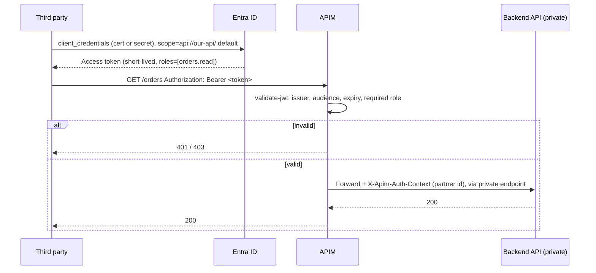

# Third party → our API (OAuth client credentials via APIM)

- Create one Entra app registration per partner, with app roles as scopes. Revoke a partner by removing its role assignment.
- APIM is the enforcement point. The backend accepts traffic from APIM only, using a private endpoint or VNet integration plus access restrictions.
- Policy: [`validate-jwt.xml`](../../examples/auth-patterns-api/apim/policies/validate-jwt.xml)
