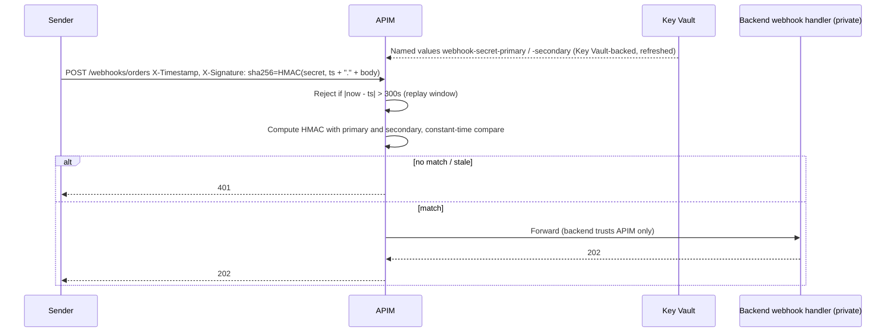

# Third-party webhook → our platform (HMAC verified in APIM)

- Use one secret per sender. Rotate by putting the new secret in the secondary slot, cutting the sender over, promoting it to primary, then clearing the old one.
- Optional extras: an IP allowlist, and deduplicating on the event ID in the backend.
- Policy: [`verify-webhook-hmac.xml`](../../examples/auth-patterns-api/apim/policies/verify-webhook-hmac.xml)
