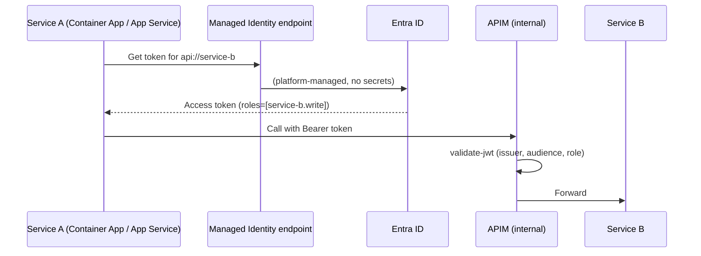

# Internal service-to-service (Managed Identity)

- Managed Identity is the default, because there are no secrets to store or rotate. Grant app roles to the calling identity.
- Use OAuth with an app registration only when Managed Identity isn't available, for example across tenants or outside Azure.
