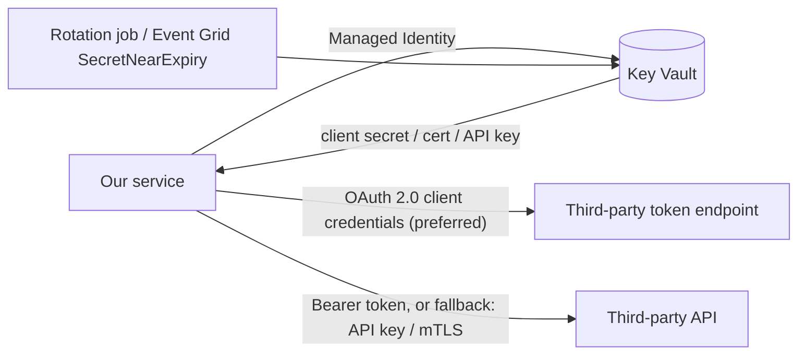

# Our service → third-party API (secrets in Key Vault)

- Prefer OAuth 2.0 where the third party supports it. Otherwise use API keys or mTLS certificates.
- Keep credentials in Key Vault only, and read them at runtime with Managed Identity. Never put them in pipelines, config or source.
- Rotate on a schedule, and use Key Vault near-expiry events to alert the owning team.
