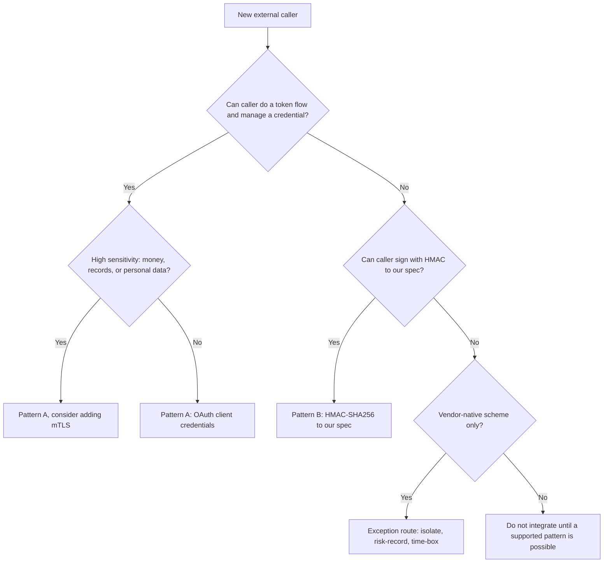
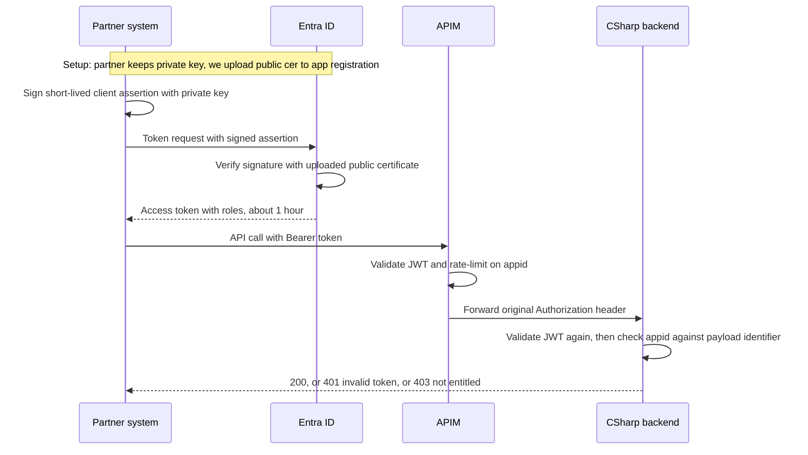
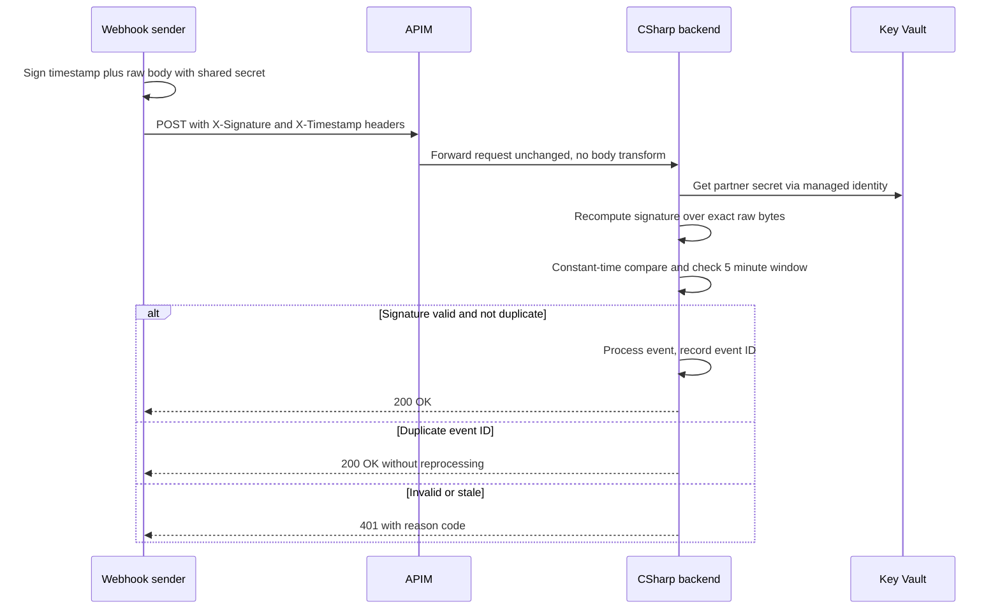

# Third-Party API Access Patterns

*Platform capability for external systems calling our APIs in Azure.*
*Sanitised pattern document: all tenant IDs, hostnames, secrets, and identifiers below are placeholders.*

---

## Overview

External third parties do not get a one-off authentication design per project. They are onboarded into one of a small, fixed set of platform patterns, built once and reused.

This document defines:

- **Pattern A (preferred): OAuth 2.0 client credentials** with Microsoft Entra ID, a per-partner app registration, and a certificate credential.
- **Pattern B (supported fallback): HMAC-SHA256** request signing to our published specification, for webhook senders and simpler partners who cannot perform a token flow.
- **Exception route:** a vendor-native scheme (for example a SaaS product's own webhook signing variant, mTLS, or a static key) accepted case-by-case, isolated, risk-recorded, and time-boxed.

Why not a single pattern? We do not control the other end:

1. **A partner building a client specifically to call our API** — we dictate the terms. Use Pattern A.
2. **A SaaS product firing webhooks at us** — they dictate the terms: their headers, signing variant, and retry behaviour. Use Pattern B if they can follow our spec, otherwise the exception route behind a dedicated ingress.
3. **A strategic or high-sensitivity partner** — regulated data, value movement, or record changes. Use Pattern A, optionally layered with mTLS, and justify any departure explicitly.

### Decision guidance

| Question | Guidance |
|---|---|
| Can the caller fetch and cache a token, and manage a certificate or secret? | Pattern A |
| Is the caller a webhook sender that just POSTs and retries, with no token step? | Pattern B, or exception route if it cannot follow our spec |
| Does the endpoint move money, change records, or carry personal / regulated data? | Pattern A only (optionally plus mTLS). Never a static key alone |
| Low-sensitivity notification only (for example a status ping)? | Pattern B is acceptable |
| Vendor offers only its own signing / auth scheme? | Exception route: dedicated endpoint, recorded risk decision, compensating controls, expiry date for the exception |

### Choosing a pattern



---

## Shared platform principles

These apply to both patterns:

- **APIM is not the only line of defence.** APIM validates at the edge; the backend service validates independently. Anything that can reach the backend directly must not bypass authentication.
- **Identity is per partner, per environment.** Separate registrations / secrets for test and live. Revoking one partner must not affect another.
- **Secrets and keys live in Key Vault**, accessed via managed identity. Never in code, config in source control, or APIM named values in plain text (use Key Vault references in APIM).
- **Build shared components once:** APIM policy fragments (deployed via Bicep / AVM), a shared .NET verification library with published test vectors, a partner register, an onboarding pack, and a sandbox. No squad hand-rolls its own JWT or signature verification.
- **Log partner ID and failure reason on every rejection** (never log secrets, signatures, private keys, or full tokens), and make it dashboardable so "your API is rejecting us" can be answered in seconds.
- **A subscription key in APIM is not authentication.** At most it is a product / throttling key. It must never be treated as identity.

Relevant stack: Azure API Management (APIM), Microsoft Entra ID, App Services / Functions / Container Apps, Key Vault, managed identities, Bicep / AVM, C# / ASP.NET Core backends.

---

## Pattern A — OAuth 2.0 client credentials (preferred)

Best for: a partner system building an API client to our specification — synchronous calls, their developers writing code against our API.

### How identity is issued

1. We create **one app registration per partner, per environment** in our Entra tenant. The partner is never invited as a guest user; the registration represents their system, not a person.
2. We define **app roles** on our API app registration (for example `Webhooks.Submit`, `Orders.Submit`) and assign the partner's registration only the roles it needs.
   - App-only (machine-to-machine) tokens carry entitlements in the **`roles`** claim.
   - Delegated (user) tokens carry them in **`scp`**. Checking `scp` in an app-only token is a common failure.
3. For the credential we prefer a **certificate** (see below). A client secret is a fallback only, with an agreed expiry.

### The certificate credential — how it works

The private key never leaves the partner's estate, and we never hold anything that could impersonate them.

**Setup:**

1. The partner generates an asymmetric key pair (RSA 2048-bit or better) in their own store, Key Vault, or HSM. A self-signed certificate is acceptable here: trust does not come from a certificate authority chain, it comes from the next step.
2. The partner sends us **only the public certificate** (`.cer`).
3. We upload that public certificate to their app registration in our tenant under *Certificates & secrets > Certificates*.
4. We verify the certificate thumbprint with the partner over a separate channel, because whoever's public key is uploaded is who Entra will trust.

> **Hard rule:** if a partner sends a `.pfx` file or a private key / password, stop. Accepting private key material defeats the entire design.

**Runtime — obtaining a token:**

1. The partner builds a short-lived JWT client assertion: issuer and subject are their `client_id`, audience is our tenant token endpoint, expiry is a few minutes out, with a unique ID. The header carries their certificate thumbprint (`x5t`).
2. They sign that assertion with their **private key** and POST it to the Entra token endpoint using the client credentials grant, presenting the signed assertion *instead of* a client secret. In .NET this is `WithCertificate(cert)` in MSAL; equivalent libraries exist for Java, Python, and Node.
3. Entra finds the uploaded certificate by thumbprint, verifies the signature with the public key, and — only if valid — issues a normal access token (typically about 1 hour) containing their app roles. Scope: `api://<api-app-id>/.default`.
4. The partner caches that token, refreshes it before expiry (not one token request per API call), and calls APIM with `Authorization: Bearer <token>`.

Neither APIM nor the backend ever sees the certificate or the client assertion. That exchange happens only between the partner and Entra.

> **Not mTLS:** here the certificate is presented once, at Entra, to obtain a token. In mTLS the certificate is presented during the TLS handshake directly to APIM on every API call. The two can be layered for very high sensitivity, but they solve different problems.

### Validation — APIM and backend

**At APIM**, a `validate-jwt` policy (as a reusable policy fragment, scoped per API / operation) checks signature against Entra's published keys, expiry, issuer, audience, and coarsely the `roles` claim, and rate-limits per partner on the `appid` claim so one noisy partner cannot swamp the rest.

```xml
<validate-jwt header-name="Authorization" failed-validation-httpcode="401">
  <openid-config url="https://login.microsoftonline.com/<tenant-id>/v2.0/.well-known/openid-configuration" />
  <audiences><audience>api://<api-app-id></audience></audiences>
  <required-claims>
    <claim name="roles" match="any"><value>Webhooks.Submit</value></claim>
  </required-claims>
</validate-jwt>
```

**In the C# backend**, the same token is validated independently, and the original `Authorization` header must be forwarded by APIM untouched:

```csharp
builder.Services.AddAuthentication(JwtBearerDefaults.AuthenticationScheme)
    .AddMicrosoftIdentityWebApi(builder.Configuration.GetSection("AzureAd"));

app.UseAuthentication();
app.UseAuthorization();
```

Configuration points at our tenant as authority and `api://<api-app-id>` as audience. The middleware verifies signature, issuer, audience, and expiry on every request.

Do **not** let APIM swap the partner token for its own managed-identity token and discard the original: the backend would then know "this came from APIM" but not *which partner*, and per-partner authorisation collapses. If APIM-to-backend managed identity is used as an additional trust layer, preserve the original partner claims alongside it.

**Resource-level authorisation (backend only):** authentication proves "a valid partner with `Webhooks.Submit`". The backend must also ask "is *this* partner allowed to act on *this* data?" If the payload carries a partner / customer identifier, check it against the token `appid` claim — never trust the body's say-so.

Status codes: `401` for a missing / invalid token, `403` for a valid token doing something it is not entitled to.

**Acceptance test for every new endpoint:** call the backend directly, bypassing APIM, with no token and with a forged token. Both must fail. If they do not, authentication lives only in APIM.

### Pattern A sequence



### Rotation and revocation

- **Rotation with no downtime:** an app registration can hold multiple certificates. Partner generates a new pair, we upload the new public certificate alongside the old, the partner switches signing, we remove the old certificate.
- **Expiry tracking:** certificates typically live 1–2 years. The partner register must track expiry, with alerting at 60 / 30 / 7 days. An expired certificate fails all token requests at once.
- **Revocation:** remove the public certificate from the app registration and/or pull the app role — no new tokens from that moment.
- **Emergency caveat:** access tokens already issued remain valid until they expire (up to about 1 hour). For an instant kill, also block that `appid` at APIM.
- Client secrets, where used as a fallback, follow the same register / expiry / dual-credential rotation discipline.

### Pattern A failure modes to check first

- Audience mismatch (v1 vs v2 token versions, missing `api://` prefix).
- Looking for `scp` in an app-only token (should be `roles`).
- Missing admin consent on app roles.
- Partner sending private key material (refuse it).
- Backend trusting APIM as its only check, or APIM replacing the partner token.

---

## Pattern B — HMAC-SHA256 (supported fallback)

Best for: webhook senders and simpler partners who physically cannot fetch and rotate a token before each call. HMAC proves the payload was not altered and that the sender holds a shared secret. It does not encrypt (HTTPS does that), and it does not identify a sender beyond "holder of this secret" — which is why the secret is **per partner**.

This is HMAC **to our published specification**, not the partner's interpretation of it.

### Our specification

- Algorithm: HMAC-SHA256.
- Signing string: `"{timestamp}.{rawBody}"` — the timestamp, a dot, then the **exact raw bytes received**.
- Headers (example names, fixed in the published spec): `X-Timestamp` and `X-Signature`.
- Encoding (hex or Base64) and UTF-8 handling are stated explicitly in the spec; never left to guesswork.
- Timestamp tolerance: reject anything older than about 5 minutes, to limit replay.
- Comparison: constant-time, in C# via `CryptographicOperations.FixedTimeEquals`. A naive string comparison can leak timing information.
- Secret: per partner, per environment, stored in Key Vault and read via managed identity. Never in code or in APIM plain-text named values.
- Verification point: **in the backend**, as the first step of the request pipeline, **before** the body is deserialised. APIM handles TLS, throttling, and routing. APIM policy expressions *can* do HMAC, but it is painful, hard to test, and brittle — do not put it there.

### Runtime flow

1. The sender computes the signature over the signing string with the shared secret and sends the normal HTTPS request with the signature and timestamp headers.
2. APIM terminates TLS, applies throttling / routing, and forwards the request.
3. The backend reads the raw body, recomputes the signature with its copy of the secret from Key Vault, compares in constant time, and checks the timestamp window.
4. On match, the backend checks idempotency (below) and processes. On mismatch or stale timestamp, it rejects with `401` and a reason code.

### Idempotency and retries

Webhook senders retry, so legitimate duplicates will arrive. Use the sender's event ID header (or a hash of the signature) as an idempotency key: acknowledge a duplicate with `200` without reprocessing.

### Rotation

Accept **two secrets at once** (current and next) during a switchover window, so the partner can flip at their end without a coordinated cutover minute. Both secrets are tracked in the partner register.

### Pattern B sequence



### Pattern B failure modes (the usual causes of "signature mismatch")

1. **Signing a reserialised body.** Anything that parses and re-emits JSON (including an APIM transformation policy) changes whitespace / property order and breaks the signature. Always hash the raw bytes as received, before model binding.
2. **Encoding mismatches.** Hex vs Base64 output, UTF-8 assumptions, or a secret treated as Base64 when it was issued as plain text. Agree encodings explicitly in the spec and test vectors.
3. **Secret confusion across environments.** Test system signing with the live secret or vice versa. Per-environment secrets, clearly labelled.
4. Signing only the body with no timestamp (replayable forever).
5. Nine teams hand-rolling nine subtly different verifiers (use the shared .NET library).

### Vendor-native webhooks (exception route within Pattern B's world)

Where a SaaS vendor only supports its own signing variant, verify *their* signature in one small dedicated ingress (for example a Function behind APIM), then translate into our internal event format and forward using managed identity. Vendor-specific weirdness stays quarantined at the edge rather than leaking into domain services. Each such integration needs a recorded risk decision, compensating controls such as IP allow-listing where appropriate, and an expiry / review date.

---

## Comparison

| Aspect | Pattern A: OAuth client credentials | Pattern B: HMAC-SHA256 |
|---|---|---|
| Caller must do | Fetch, cache, and refresh a token; manage a certificate (or fallback secret) | Sign each request; no token step |
| Identity | Real per-partner identity (`appid`), granular app roles | Shared secret effectively *is* the partner; no finer granularity |
| Shared secret | None for certificate credential — we hold only public material | Yes — both sides must protect it; stored in Key Vault our side |
| Authorisation | `roles` claim, enforced at APIM and backend, plus backend resource-level checks | Per-partner secret plus backend resource-level checks; no scopes / roles |
| Expiry / revocation | Tokens about 1 hour; remove cert / pull role to revoke; block `appid` at APIM for instant kill | No built-in expiry; rotate / withdraw the secret; timestamp window limits replay |
| Replay protection | Token expiry; transport via HTTPS | Timestamp in signing string plus 5-minute tolerance, plus idempotency |
| Best for | Partners building a client to our spec; higher sensitivity | Webhook senders and simpler partners; lower sensitivity |
| Main operational burden | Certificate expiry tracking, onboarding | Secret rotation coordination, signature-mismatch debugging |

Rule of thumb: **OAuth preferred, HMAC to our spec as fallback, everything else by exception** — and enforce that in API design review so squads stop inventing per-project answers.

---

## Platform capabilities to build once

| Capability | What it is |
|---|---|
| APIM policy fragments | Bicep / AVM-deployed reusable fragments for JWT validation, per-partner rate-limiting on `appid`, and partner identification. A new partner becomes configuration, not new policy code |
| Shared .NET verification library | One packaged library for JWT and HMAC verification, with published test vectors. Nobody writes their own signature comparison |
| Partner register | Partner, pattern, roles / secret references (references, not values), certificate thumbprints, expiry dates, technical contact, environment. Alert at 60 / 30 / 7 days before any expiry |
| Onboarding pack and sandbox | The spec, worked examples, and a test endpoint that returns *why* validation failed as reason codes (bad audience vs expired timestamp vs wrong encoding) without leaking secrets. This is what turns a 3-month integration into 2 weeks |
| Standard logging and dashboarding | Partner ID and failure reason on every rejected call; no secrets, signatures, or full tokens in logs |
| Vendor webhook ingress | One quarantined ingress pattern for exception-route SaaS webhooks: verify vendor signature, translate to internal format, forward via managed identity |

At low partner volumes this stays lightweight (template plus runbook). At higher volumes the register, expiry alerting, and self-service sandbox testing are what pay for themselves.

---

## Onboarding checklist

### For every partner

- [ ] Pattern selected (A, B, or exception) and sensitivity rationale recorded; exception route has a risk decision and review date
- [ ] Separate identity / secret for test and live
- [ ] Entry created in the partner register: pattern, contact, environment, expiry dates
- [ ] Sandbox tested, including deliberate failure cases (wrong audience, stale timestamp, wrong encoding) returning clear reason codes
- [ ] Rejection logging verified: partner ID and failure reason visible in the dashboard
- [ ] Rotation and offboarding process agreed and documented with the partner

### Pattern A specific

- [ ] Per-partner app registration created; only the required app roles assigned and consented
- [ ] Partner generated their key pair; we received **only** the public `.cer`; thumbprint confirmed out-of-band; no `.pfx` / private key ever received
- [ ] Partner confirms private key storage (their vault / HSM) and their rotation contact
- [ ] Certificate expiry date recorded, with 60 / 30 / 7 day alerts set
- [ ] APIM `validate-jwt` scoped correctly for the API / operation; rate-limit on `appid` configured
- [ ] Backend validates the token independently and performs resource-level authorisation (`appid` vs payload identifier)
- [ ] Direct-to-backend bypass test passed (no token and forged token both rejected)

### Pattern B specific

- [ ] Partner has our published HMAC spec, including headers, signing string, encoding, and test vectors
- [ ] Per-partner secret generated, stored in Key Vault, referenced (never plain text) by the backend; partner stores it in their vault / config
- [ ] Backend verifies over exact raw bytes before deserialisation, with constant-time compare and 5-minute timestamp tolerance
- [ ] Idempotency on event ID confirmed, including retry behaviour
- [ ] Dual-secret rotation window agreed

### Offboarding / revocation

- [ ] Pattern A: remove public certificate and/or app role assignment; block `appid` at APIM if instant effect is needed (issued tokens otherwise live until expiry)
- [ ] Pattern B: withdraw / rotate the partner secret; remove the partner's endpoint / route if fully decommissioned
- [ ] Partner register updated; monitoring / alert entries removed

---

## Open questions for design discussion

- What sensitivity tiers do we formally map to "Pattern A only", and who signs off an exception?
- Do we offer federated credentials (partner exchanges a token from their own IdP) as a Pattern A variant, and for which partner types?
- What is our expected integration volume per year? That decides how much of the register / sandbox to automate now versus later.
- For very high-sensitivity partners, when do we require mTLS in addition to Pattern A, and who operates it at APIM?

*All examples use placeholders such as `<tenant-id>` and `api://<api-app-id>`. No real tenant IDs, hostnames, secrets, or customer data belong in this document or in onboarding material derived from it.*
