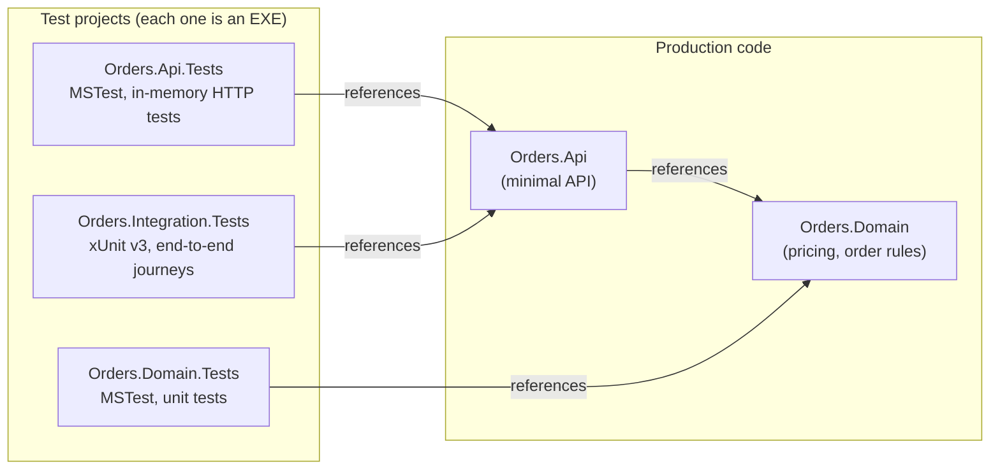
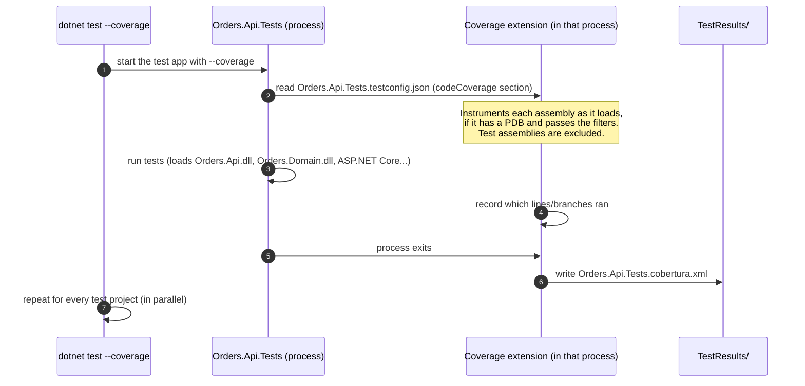
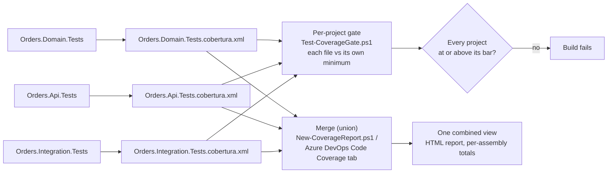
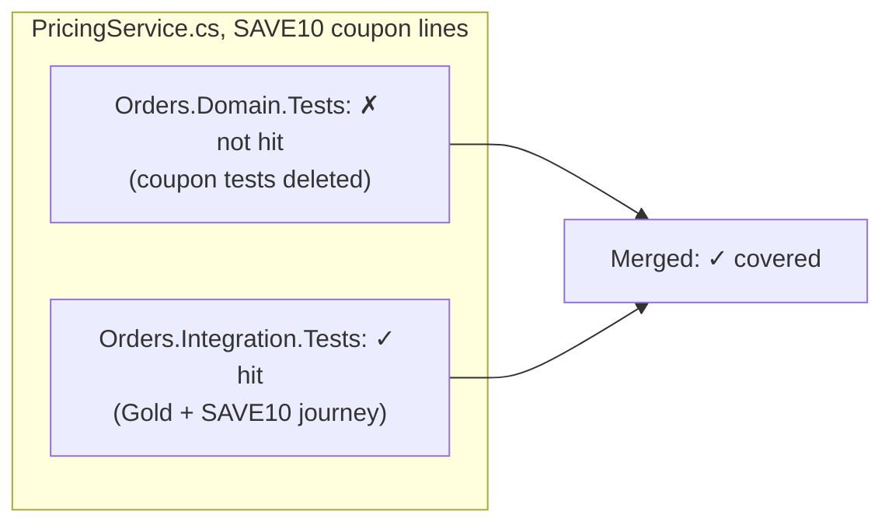
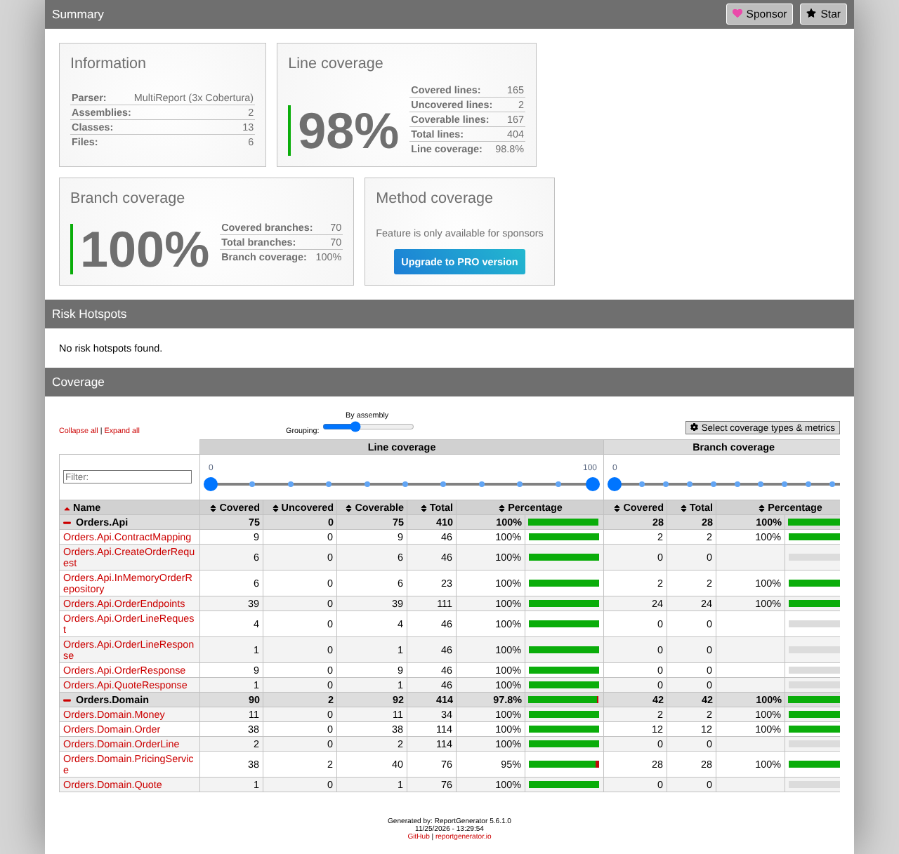
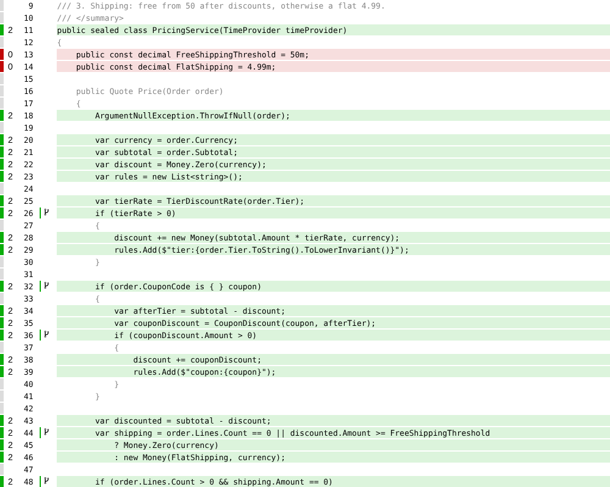
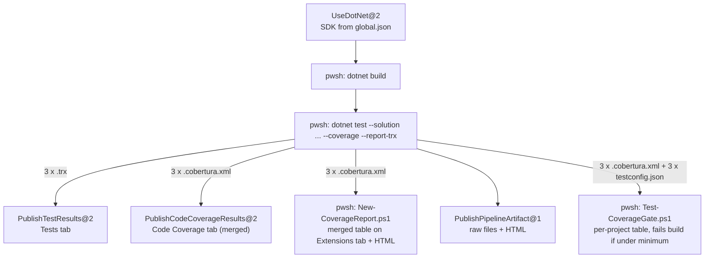

# How Code Coverage Works Across Several Test Projects

Every number on this page comes from running this solution (58 tests across three test projects) on
the .NET 10 SDK. Run [`scripts/Show-CoverageModes.ps1`](../scripts/Show-CoverageModes.ps1) to
reproduce the tables yourself.

If MTP itself isn't running yet, start with [Setting Up MTP](setting-up-mtp.md).

---

## The Short Version

1. **Coverage is collected per test process.** Each test project is its own process and writes its own
   report. A report only knows about code *that process* ran.
2. **A production assembly can appear in several reports.** Whatever a test project loads (directly or
   through other projects) can be measured, unless that project's filters exclude it.
3. **Merging is a union, not an average.** In the merged report a line is covered if *any* test project
   ran it. Merged coverage is always at least as high as the best single project.
4. **So merged coverage can hide gaps.** Remove unit tests, and the merged number may not move if an
   integration test still runs the same lines. Per-project numbers show it.
5. **A percentage means nothing without its filters.** The same tests give `Orders.Api` **50.5%** or
   **100%**, depending only on what is included.

The rest of this page shows each of these with real output.

---

## The Example Solution



`Orders.Api.Tests` and `Orders.Integration.Tests` only reference `Orders.Api`. But the API calls the
domain, so **their processes load and run `Orders.Domain.dll` too**. That one fact explains most of
the confusing numbers.

---

## 1. What Happens During One Test Run



What's measured:

- **Only assemblies loaded into that process.** `Orders.Domain.Tests` never loads `Orders.Api.dll`,
  so its report can't mention the API at all.
- **Only assemblies with symbols (PDBs).** Your own projects have them. Framework and NuGet assemblies
  generally don't, so they don't show up.
- **Then the `testconfig.json` filters apply:** `ModulePaths`, `Sources`, `Attributes` and so on.

Microsoft's coverage records **whether** a line ran (`hits="0"` or `hits="1"`), not how many times.
In every report here, every `hits` value is 0 or 1.

---

## 2. Each Project Writes Its Own Report



Two questions, two consumers:

| Question | Answered by | Where you see it in Azure DevOps |
|---|---|---|
| "Did *this* test project test *its* code well enough?" | each report on its own, the gate | **Extensions** tab (gate table), build result |
| "How much of the codebase ran in *any* test?" | the merged report | **Code Coverage** tab, plus the merged table on **Extensions** |

---

## 3. The Same Code, Measured Several Ways

`./scripts/Show-CoverageModes.ps1` runs every project twice: once with **no filters**, once with
**the project's own `testconfig.json`**. It then merges each set. Line coverage per assembly:

### No filters

| Assembly | Orders.Api.Tests | Orders.Domain.Tests | Orders.Integration.Tests | MERGED |
|---|---:|---:|---:|---:|
| Orders.Api | 50.5% | not measured | 47.6% | 50.5% |
| Orders.Domain | 85.8% | 97.8% | 83.6% | 97.8% |

### With each project's `testconfig.json` (what CI uses)

| Assembly | Orders.Api.Tests | Orders.Domain.Tests | Orders.Integration.Tests | MERGED |
|---|---:|---:|---:|---:|
| Orders.Api | 100.0% | not measured | 84.0% | 100.0% |
| Orders.Domain | not measured | 97.8% | 83.6% | 97.8% |

How to read them:

- **"not measured" in the Domain.Tests column for Orders.Api:** that process never loaded the API.
- **Orders.Domain in the Orders.Api.Tests column, unfiltered (85.8%):** HTTP tests ran 85.8% of the
  domain without asserting a single pricing rule directly. That's why `Orders.Api.Tests` filters to
  `Orders.Api.dll` only. Otherwise HTTP tests would get credit for testing business rules.
- **Orders.Api unfiltered is 50.5%; filtered, 100%.** The tests are the same. The unfiltered run counts
  source-generated code under `obj/` (validation, OpenAPI, request delegates) and `Program.cs` wiring.
  Excluding generated code is normal. Excluding `Program.cs` is a team choice. **Either way, say what
  the filters are whenever you quote a number.**
- **The integration project measures both assemblies on purpose.** That's what journey tests do. Its
  gate is deliberately low (60% line) because "this code ran" isn't "this code is tested".
- **MERGED is never lower than any column to its left.** It's a union.

---

## 4. Merging Is a Union, and It Can Hide Gaps

For each source line, the merged report asks: did **any** report hit this line?



To show this for real, we ran `Orders.Domain.Tests` *without* its four coupon tests
(`--filter "FullyQualifiedName!~Save10&FullyQualifiedName!~TierDiscountThenCoupon"`), as if someone
had deleted them:

| | Orders.Domain line coverage | PricingService line coverage |
|---|---:|---:|
| Orders.Domain.Tests, all tests | 97.8% | 95.0% |
| Orders.Domain.Tests, coupon tests removed | **96.7%** | **92.5%** |
| Merged with Orders.Integration.Tests, coupon tests removed | **97.8%** | **95.0%** |

**The merged number didn't move.** The integration test still runs the SAVE10 lines, so the combined
report shows them as covered, even though no unit test checks the coupon rules any more. Only the
per-project number showed the drop.

That's why this example gates **each project against its own minimum** and treats the merged
number as an overview, not a quality bar.

(The per-project gate still passed here: 96.8% against a 95% minimum. Four tests are a small slice of
the suite. A minimum catches erosion over time, not one deleted test. Code review catches that.)

---

## 5. Why Your Numbers Don't Match Someone Else's

Check these, in this order:

1. **Different filters.** Compare the `codeCoverage` sections. Section 3 shows 50% versus 100% from
   filters alone.
2. **Per-project versus merged.** A per-project number and the Azure DevOps Code Coverage tab answer
   different questions (section 2).
3. **Different counting rules.** Microsoft's Cobertura writer counts a source line once *per method*
   that contains it. ReportGenerator (and the merged views) count each *source line* once. For
   `Orders.Domain.Tests` that's 92 of 94 lines (**97.9%**) versus 90 of 92 (**97.8%**). Same tests,
   same code. Expect a few tenths of a percent, never more.
4. **Different test runs.** A `--filter`, a skipped project, or a test that didn't run changes the
   numbers. Check the TRX counts.
5. **Code that can never run.** The two uncovered lines in `Orders.Domain` are:

   ```csharp
   public const decimal FreeShippingThreshold = 50m;
   public const decimal FlatShipping = 4.99m;
   ```

   C# can't store a `decimal` constant as a true IL constant, so the compiler puts it in a static
   constructor. Every use is inlined, so that constructor never runs, and the coverage tool reports
   two lines nobody can cover. Expect a few of these in any codebase. Don't chase them to 100%.

---

## 6. Evaluating Results

### The HTML report

`./scripts/Invoke-TestCoverage.ps1` writes `TestResults/CoverageReport/index.html`: all projects
merged, built with ReportGenerator.



- **Covered / Uncovered / Coverable** are counts of source lines. *Total* includes blank lines and
  comments, which aren't coverable.
- **Branch coverage** counts both outcomes of each `if`, `?:`, `&&`, `switch` arm and so on. A line can
  be "covered" while one branch on it never ran. Branch coverage is usually the more honest number.
- **Risk Hotspots** lists complex methods with low coverage. Start there.

Click a class to see its source:



- **Green** = at least one test project ran it. **Red** = no test project ran it. **No colour** =
  not coverable (declarations, braces, comments).
- **The number in the left margin is how many reports hit that line**, not how many times it ran.
  Microsoft's coverage writes hits as 0 or 1 per report, so "2" here means two test projects ran it
  (`Orders.Domain.Tests` and `Orders.Integration.Tests`). A "1" tells you only one project covers that line.
- **The flag icon** next to a line marks branches. Hover it to see how many outcomes were taken.

### Azure DevOps

| Tab | Shows | Fed by |
|---|---|---|
| **Tests** | Pass/fail per test, one run per test project | `PublishTestResults@2` with the `.trx` files |
| **Code Coverage** | One merged report for the whole run, with HTML | `PublishCodeCoverageResults@2` with every `.cobertura.xml` |
| **Extensions** | Per-project gate table, and the merged per-assembly table | the two PowerShell scripts, via `##vso[task.uploadsummary]` |

Azure DevOps keeps **one** coverage report per run, so there is no per-project view on the Code
Coverage tab. That's what the Extensions tab table is for.

### Reviewing a pull request

1. **Gate table first.** Has any project's number dropped? A new test project without a
   `testconfig.json` fails the gate ("test project has no testconfig.json"), so it can't slip in ungated.
2. **Look at new red lines in changed files**, not at the total. A 0.2% drop in a large codebase can be
   an entire new, untested class.
3. **Check the margin number on critical code.** If a business rule shows "1" and that one project is
   the integration suite, nobody is asserting on that rule.
4. **Be wary of filter changes.** A PR that edits `ModulePaths`, `Sources` or `Attributes` excludes
   can raise coverage without adding a test.

---

## 7. How the Pipeline Puts It Together



The steps are in [`pipelines/templates/dotnet-test-mtp.yml`](../pipelines/templates/dotnet-test-mtp.yml).
The publish steps run with `succeededOrFailed()`, so failed tests still show up on the Tests tab.
The gate only runs if the tests passed.

Adding a fourth test project needs **no pipeline change**: give it a `testconfig.json` with a unique
`CoverageFileName` and a `coverageGate`, and every step picks it up.

---

## Glossary

| Term | Meaning |
|---|---|
| **Line coverage** | Coverable lines that ran, divided by all coverable lines |
| **Branch coverage** | Branch outcomes taken, divided by all branch outcomes (both sides of every `if`, and so on) |
| **Cobertura** | An XML coverage format: `<package>` = assembly, `<class>`, `<method>`, `<line number hits branch>`. What Azure DevOps and ReportGenerator read |
| **`.coverage`** | Microsoft's binary format, the extension's default. Opens in Visual Studio. This example asks for `cobertura` instead |
| **Instrumentation** | The coverage tool rewriting an assembly as it loads, so it can record which lines run |
| **Merge** | Combining reports so a line is covered if any report covered it |
| **Gate** | A build step that fails below a minimum. Not built into MTP: here it's `Test-CoverageGate.ps1` |
