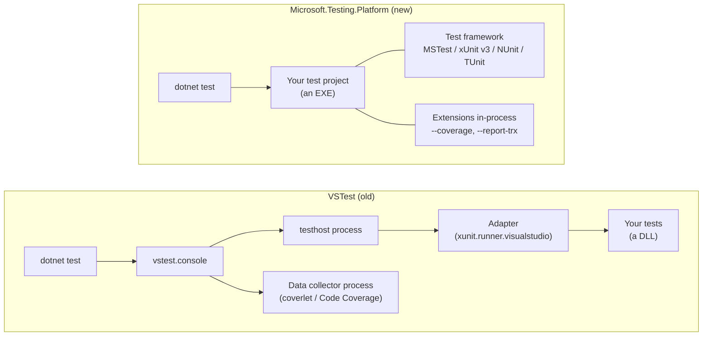

# Setting Up Microsoft.Testing.Platform (MTP)

How to turn a .NET test project into an MTP test project, run it with coverage, and fix the errors
people hit most often. Everything here was run on the .NET 10 SDK (10.0.115) with MSTest 4.5.1,
xUnit v3 4.0.3 and Microsoft.Testing.Extensions.CodeCoverage 18.12.0. Error messages and exit codes
are copied from real runs.

The companion guide, [How Code Coverage Works](how-coverage-works.md), explains what the coverage
numbers mean once tests are running.

---

## What Changed From VSTest

With VSTest, a test project is a library. `dotnet test` starts a separate host (`testhost`), which
loads your test DLL through an adapter (`xunit.runner.visualstudio`, `MSTest.TestAdapter`) and a data
collector (`coverlet.collector`, "Code Coverage") that runs in yet another process.

With MTP, **a test project is a console app**. The test framework, the runner and any extensions
(coverage, TRX) are compiled into that app. `dotnet test` only builds and starts it, then collects
its output.



What follows from that:

| | VSTest | MTP |
|---|---|---|
| The test project builds to | a DLL | an **EXE** you can run on its own |
| Coverage comes from | `coverlet.collector` or `--collect "Code Coverage"` | the `Microsoft.Testing.Extensions.CodeCoverage` package, `--coverage` |
| TRX comes from | `--logger trx` | the `Microsoft.Testing.Extensions.TrxReport` package, `--report-trx` |
| Settings file | `.runsettings` (`--settings`) | `testconfig.json` next to the project (and `--coverage-settings` for coverage XML) |
| An option a project doesn't understand | usually ignored | **the run fails** (exit code 5) |

That last row catches most teams. Each MTP test app checks every option it gets. An option that no
installed extension provides is rejected, not ignored.

---

## Step 1: `global.json` Turns On MTP Mode for `dotnet test`

From the .NET 10 SDK, `dotnet test` can drive MTP apps directly. You opt in once, next to the solution:

```json
{
  "sdk":  { "version": "10.0.100", "rollForward": "latestFeature" },
  "test": { "runner": "Microsoft.Testing.Platform" },
  "msbuild-sdks": { "MSTest.Sdk": "4.5.1" }
}
```

Without the `test` section, `dotnet test` stays in VSTest mode and MTP projects run through a
compatibility bridge with different options. Put it in, and use the commands below.

> **One mode per solution.** `dotnet test` runs a whole solution in one mode. If some test projects
> are still VSTest-only (for example xUnit v2), migrate them before you switch the solution.

---

## Step 2: The Test Project

### MSTest: `MSTest.Sdk` (recommended)

The whole project file:

```xml
<Project Sdk="MSTest.Sdk">
  <ItemGroup>
    <ProjectReference Include="..\..\src\Orders.Domain\Orders.Domain.csproj" />
  </ItemGroup>
</Project>
```

`MSTest.Sdk` sets `OutputType=Exe`, turns on the MTP runner, and adds MSTest, its analyzers, the
**code coverage** extension and the **TRX** extension. Do **not** add `Microsoft.NET.Test.Sdk`,
`MSTest.TestAdapter` or `coverlet.collector`.

### xUnit v3 (or any framework on the plain SDK)

See [`tests/Orders.Integration.Tests/Orders.Integration.Tests.csproj`](../tests/Orders.Integration.Tests/Orders.Integration.Tests.csproj).
Here you add the pieces that `MSTest.Sdk` would have added for you:

```xml
<Project Sdk="Microsoft.NET.Sdk">
  <PropertyGroup>
    <OutputType>Exe</OutputType>
    <UseMicrosoftTestingPlatformRunner>true</UseMicrosoftTestingPlatformRunner>
  </PropertyGroup>
  <ItemGroup>
    <PackageReference Include="xunit.v3.mtp-v2" />
    <PackageReference Include="Microsoft.Testing.Extensions.CodeCoverage" />
    <PackageReference Include="Microsoft.Testing.Extensions.TrxReport" />
  </ItemGroup>
</Project>
```

| Piece | Why | What happens without it |
|---|---|---|
| `OutputType=Exe` | An MTP test project is an app | It won't build as a test app |
| `xunit.v3.mtp-v2` | xUnit v3 built on MTP v2, the same major version MSTest 4 uses | — |
| `Microsoft.Testing.Extensions.CodeCoverage` | Provides `--coverage` | `--coverage` is an unknown option: exit code 5, no tests run |
| `Microsoft.Testing.Extensions.TrxReport` | Provides `--report-trx` | Same, for `--report-trx` |
| `UseMicrosoftTestingPlatformRunner` | Uses MTP when you start the exe yourself | `dotnet test` still works, but `./Orders.Integration.Tests --coverage` gets xUnit's own console runner, which has no `--coverage` (checked: `--help` lists no coverage options) |

**xUnit v2 does not run on MTP.** `xunit` + `xunit.runner.visualstudio` is VSTest only. Move to
`xunit.v3.mtp-v2`. Most tests compile unchanged. The main change is `TestContext.Current.CancellationToken`
for cancellation.

**Central Package Management gotcha.** `MSTest.Sdk` declares its own `PackageVersion` for the coverage
and TRX extensions. If `Directory.Packages.props` declares them too, every MSTest project fails restore:

```
error NU1506: Duplicate 'PackageVersion' items found. ... Microsoft.Testing.Extensions.CodeCoverage 18.12.0,
Microsoft.Testing.Extensions.CodeCoverage 18.12.0; Microsoft.Testing.Extensions.TrxReport 2.5.1, ...
```

Declare them only for projects that aren't on `MSTest.Sdk`
([`Directory.Packages.props`](../Directory.Packages.props)):

```xml
<ItemGroup Condition="'$(UsingMSTestSdk)' != 'true'">
  <PackageVersion Include="Microsoft.Testing.Extensions.CodeCoverage" Version="18.12.0" />
  <PackageVersion Include="Microsoft.Testing.Extensions.TrxReport" Version="2.5.1" />
</ItemGroup>
```

---

## Step 3: `testconfig.json`: Per-Project Settings

Each test project has a `testconfig.json`. The build copies it next to the exe as
`<Project>.testconfig.json`, so it applies to that project only. The coverage extension reads its
settings from the `codeCoverage` section: format, output file name, include/exclude filters.

```jsonc
{
  "codeCoverage": {
    "Configuration": {
      "Format": "cobertura",
      "CoverageFileName": "Orders.Domain.Tests.cobertura.xml",
      "CodeCoverage": {
        "ModulePaths": { "Include": [ ".*Orders\\.Domain\\.dll$" ] }
      }
    }
  },
  "coverageGate": { "minimumLineRate": 95, "minimumBranchRate": 90 }
}
```

`coverageGate` is **not** an MTP setting. MTP ignores it, and
[`scripts/Test-CoverageGate.ps1`](../scripts/Test-CoverageGate.ps1) reads it. Keeping it here puts
"what is measured" and "how much must be covered" in one file per project.

> **`testconfig.json` and `--coverage-settings` can't be combined.** If a project's `testconfig.json`
> has a `codeCoverage` section and you also pass `--coverage-settings some.xml`, the run stops:
>
> ```
> Option '--coverage-settings' has invalid arguments: Both coverage settings '...nofilter.xml' and test
> config '.../Orders.Api.Tests.testconfig.json' files have been detected. Please select only one of
> these test configuration files.
> ```
>
> To use different settings for one run, pass `--config-file other.testconfig.json`, which replaces
> the project's file for that run. [`scripts/Show-CoverageModes.ps1`](../scripts/Show-CoverageModes.ps1) does this.

---

## Step 4: Run It

```powershell
# Everything: build, test with coverage, per-project gate, merged HTML report
./scripts/Invoke-TestCoverage.ps1

# Or by hand
dotnet build Orders.slnx -c Release
dotnet test --solution Orders.slnx -c Release --no-build `
    --results-directory TestResults `
    --coverage `
    --report-trx --report-trx-filename '{asm}.trx'

# One project
dotnet test --project tests/Orders.Domain.Tests --coverage

# The exe directly (same options; useful when debugging one project)
./tests/Orders.Domain.Tests/bin/Release/net10.0/Orders.Domain.Tests --coverage --results-directory TestResults
```

`TestResults/` then holds one `.cobertura.xml` and one `.trx` per test project.

---

## Troubleshooting

Reproduced against this solution:

| You ran / see | What happened | Fix |
|---|---|---|
| `dotnet test Orders.slnx` | `Specifying a solution for 'dotnet test' should be via '--solution'.` (exit 1) | `dotnet test --solution Orders.slnx` (or `--project`) |
| `--logger trx` | Exit code **5**: unknown option | `--report-trx` (needs the TrxReport extension) |
| `--collect "Code Coverage"` or `--collect "XPlat Code Coverage"` | Exit code **5** | `--coverage` (needs the CodeCoverage extension) |
| `--settings x.runsettings` | Exit code **5** | Move settings into `testconfig.json` |
| `--filter` matches nothing | `Zero tests ran`, exit code **8** | Check the filter. In CI, exit 8 is usually a real problem: keep it failing |
| `--coverage` and `--coverage-settings` | "Both coverage settings ... and test config ... have been detected" | Use one. See Step 3 |
| NU1506 duplicate `PackageVersion` | CPM + `MSTest.Sdk` both declare the extensions | Condition on `UsingMSTestSdk`. See Step 2 |
| Azure DevOps `DotNetCoreCLI@2` with `command: test` runs 0 tests and exits 5 | The task adds `--logger trx` for VSTest | Run `dotnet test` from a `PowerShell@2` step (see [`pipelines/`](../pipelines)) |
| Pipeline PowerShell fails parsing `testconfig.json` | Windows PowerShell 5.1's `ConvertFrom-Json` doesn't accept `//` comments | `PowerShell@2` with `pwsh: true` (PowerShell 7) |
| No coverage file for a project | That project has no CodeCoverage extension, or `--coverage` wasn't passed | `./YourTests --help` should list `--coverage` |

Exit codes reference: <https://aka.ms/testingplatform/exitcodes>. The ones you'll see most: `0` passed,
`2` a test failed, `5` invalid option, `8` zero tests ran.
