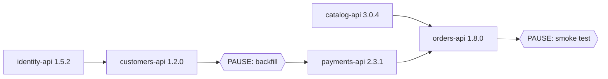

# Versioned API Releases with a Release Manifest (Azure DevOps)

Today, getting an API into live means running its pipeline off a release branch. This
experiment shows an alternative with two parts:

1. **Builds produce versioned packages, not deployments.** Every merge to `main` builds an
   immutable package such as `payments-api 2.3.1` and publishes it to an Azure Artifacts feed.
2. **A release is a manifest.** One file lists the exact version of every API, the order to
   deploy them in, and any manual pauses along the way. Merging a PR that changes the file is
   what starts a release.

The result: each release has a reviewed document that records exactly what went out. That
document also enforces the "A must go before B" rules, rather than relying on people to
remember them.

> There's no Azure DevOps org behind this sandbox, so no pipeline here has been queued for
> real. Everything that can be tested without one is: the manifest rules, the template
> expansion, the deploy scripts and the packaging. See
> [Testing Without Azure DevOps](#testing-without-azure-devops).

---

## The Shape of It

```
  API repos (x5)               Azure Artifacts feed          Release manifest
  ──────────────               ────────────────────          ────────────────
  merge to main                identity-api  1.5.2  ◄─┐      releases/release.yml
     │                         catalog-api   3.0.4    │        identity-api  1.5.2
     ▼                         customers-api 1.2.0    ├──────  catalog-api   3.0.4
  build + test ─► publish ─►   payments-api  2.3.1    │        customers-api 1.2.0  after identity
  tag commit                   orders-api    1.8.0  ◄─┘        PAUSE: backfill
                                                               payments-api  2.3.1  after backfill
                                                               orders-api    1.8.0  after catalog, payments
                                                                     │
                                                                     ▼
                                                validate ─► test ─► staging ─► prod ─► tag release/2026.11.04
```

| Folder | What it is |
|---|---|
| `apis/<api>/` | Five minimal .NET APIs. Each has its own build pipeline (`azure-pipelines.yml`) and its own `release-rules.yaml`. |
| `pipelines/templates/build-api.yml` | Shared build template: test, `dotnet publish`, zip, publish a Universal Package, tag the commit. |
| `releases/release.yml` | **The release manifest.** |
| `pipelines/templates/release.yml` | The release template that the manifest extends. It turns the manifest into stages and jobs. |
| `pipelines/templates/deploy-api-steps.yml` | Deploys one API: live version check, deploy to staging slot, wait, swap, verify. |
| `pipelines/scripts/` | The scripts those templates run: `assemble-package.sh` builds a package, and the deploy checks (`check-live-version.sh`, `wait-for-version.sh`, `verify-production.sh`). |
| `scripts/` | The manifest validator (`validate-manifest.cs`) and the four test files. See [Testing Without Azure DevOps](#testing-without-azure-devops). |

---

## 1. Builds Publish Versions, Not Deployments

Each API's pipeline is short (`apis/payments-api/azure-pipelines.yml`):

```yaml
name: 2.3.$(Rev:r)          # the build number IS the package version: 2.3.1, 2.3.2, ...
trigger:
  branches: { include: [main] }
extends:
  template: ../../pipelines/templates/build-api.yml
  parameters:
    api: payments-api
    project: .../PaymentsApi.csproj
```

The template runs `dotnet publish -p:Version=2.3.1`, zips the output, and publishes a
**Universal Package** called `payments-api`, version `2.3.1`, to the `api-releases` feed. The
package contains:

- `app.zip`: ready for App Service zip deploy
- `release-rules.yaml`: what this version needs to be deployed after (see below)
- `build-info.json`: the commit, branch and build that produced it

It also tags the commit `payments-api/v2.3.1`. A few details matter here:

- **Only `main` publishes.** PR builds compile and test but never produce a package. So nothing
  unreviewed can end up in a manifest.
- **Packages are immutable.** Azure Artifacts won't accept a second `payments-api 2.3.1`. When
  a manifest names a version, it always means the same files.
- **Versioning is boring on purpose.** `major.minor` lives in the pipeline's `name:` and the
  patch number counts up by itself. Bump the minor by editing one line. Swap in GitVersion
  later if you like. Nothing downstream cares how the number is chosen.
- **The API reports its own version** on `GET /version`. The release pipeline uses that to
  skip APIs that are already up to date, and to prove the swap worked.
- **No environment config goes in the package.** All config comes from App Settings, Key Vault
  or App Configuration. That's what lets one zip move from test to prod untouched.

---

## 2. The Release Manifest

[`releases/release.yml`](releases/release.yml), trimmed:

```yaml
extends:
  template: ../pipelines/templates/release.yml
  parameters:
    release: '2026.11.04'
    steps:
      - id: deploy_identity
        deploy: identity-api
        version: 1.5.2

      - id: deploy_catalog
        deploy: catalog-api
        version: 3.0.4

      - id: deploy_customers
        deploy: customers-api
        version: 1.2.0
        dependsOn: [deploy_identity]

      - id: backfill_billing_profiles
        manual: Run the billing-profile backfill
        environments: [staging, prod]
        dependsOn: [deploy_customers]
        instructions: |
          1. Run the "customers-billing-backfill" WebJob ...
          3. Check the "Customers without billing profile" tile reads 0.

      - id: deploy_payments
        deploy: payments-api
        version: 2.3.1
        dependsOn: [backfill_billing_profiles]

      - id: deploy_orders
        deploy: orders-api
        version: 1.8.0
        dependsOn: [deploy_catalog, deploy_payments]

      - id: checkout_smoke_test
        manual: Smoke test the checkout journey
        environments: [prod]
        dependsOn: [deploy_orders]
        instructions: ...
```

- **Every API is listed, every time.** The manifest describes the whole of live after the
  release, not only what changed. An unchanged API costs one HTTP call: the pipeline sees live
  already reports that version and skips it.
- **`dependsOn` is the order.** Steps with nothing between them run in parallel. Here,
  identity and catalog go out together.
- **`manual` steps are pauses with instructions.** They become Azure DevOps
  [Manual Validation](https://learn.microsoft.com/en-us/azure/devops/pipelines/tasks/reference/manual-validation-v1)
  tasks. The pipeline stops and shows the approver the instructions, then carries on when they
  resume, or stops the release if they reject. `environments` limits a pause to where it's
  needed. In `test`, the backfill becomes an instant no-op and the run shows it was skipped on
  purpose.

### Why the manifest is a pipeline file

Azure DevOps builds the stage and job graph when a run is **queued**, from template parameters.
It can't read a data file at run time and create jobs from it. So the manifest `extends` the
release template, and the template loops over `steps`:

- each deploy step becomes a `deployment` job
- each manual step becomes an agentless job
- `dependsOn` is copied straight across

In the run, you see your manifest as the job graph, once per environment:



---

## 3. "API A Has to Go Before API B": How It's Enforced

There are two halves, and they belong to different people.

**The API team states the rule, once, next to the code.** Here is
`apis/payments-api/release-rules.yaml`:

```yaml
api: payments-api
deployAfter:
  - api: customers-api
    minVersion: 1.2.0
    reason: Calls GET /customers/{id}/billing-profile, which was added in customers-api 1.2.0.
```

The file ships **inside the package**. So the rules checked at release time belong to the
exact version being released, not to whatever is on `main` today. When payments-api 2.4.0
drops that dependency, its package stops declaring it.

**The release owner arranges the manifest, and the validator checks it against every rule.**
It runs as the first stage of every release, and on the release PR:

| Rule | Example failure |
|---|---|
| **Order.** B's deploy step must depend on A's, directly or through other steps. | `payments-api must be deployed after customers-api, but step "deploy_payments" doesn't depend on "deploy_customers", directly or through another step. Why: Calls GET /customers/{id}/billing-profile… Fix: add deploy_customers to deploy_payments's dependsOn.` |
| **Minimum version.** The A version this release ships must satisfy B's `minVersion`. | `payments-api 2.3.1 needs customers-api >= 1.2.0, but this release pins customers-api 1.1.4.` |
| **No cycles.** | `dependsOn has a cycle, so nothing in it could ever start: deploy_identity → deploy_orders → … → deploy_identity.` |
| **Complete.** Every API listed once, at an exact `x.y.z` version. | `orders-api is missing. List every API in every release…` |
| **No typos.** Unknown keys are errors. Azure DevOps would silently ignore `depends_on`, and the release would run in parallel. | ``unknown key `depends_on`. Deploy steps allow: id, deploy, version, dependsOn.`` |
| **Manual steps are usable.** They need instructions, and only real environment names. | `unknown environment "production". Environments: test, staging, prod.` |

"Through other steps" matters. In the real manifest, `deploy_payments` depends on the
backfill, which depends on `deploy_customers`. That satisfies the rule without listing both.

**Why not work out the order automatically?** The validator could do that. It deliberately
doesn't, because the manifest doubles as the runbook. Reviewers and approvers should be able to
read the order in the PR. The pauses that people care about (backfills, flag flips, smoke
tests) aren't something the rules can know about anyway. The rules guarantee that a
hand-written order is never *wrong*. Humans decide everything else.

---

## 4. What a Release Run Does

`validate ─► deploy_test ─► deploy_staging ─► deploy_prod ─► record`

1. **validate**
   - Fails if `release/<name>` is already tagged, so every release gets a new name.
   - Downloads every package at its manifest version. A version that doesn't exist fails here,
     before anything touches an environment.
   - Runs the validator against the `release-rules.yaml` files inside those packages.
   - Attaches a **Release summary** tab to the run: a version table, the order, and the manual
     step instructions.
   - Publishes the packages as a pipeline artifact. Every later stage deploys those exact
     files.
2. **deploy_\<env\>**: one job per manifest step, wired up by `dependsOn`. For each API:
   - Check `/version` on live. If it's already at the target version, skip the rest.
   - Deploy to the `staging` slot and wait for the slot to report the new version.
   - Swap the slot into production and check that production reports the new version.
3. **record**: tags the commit `release/2026.11.04`.

To answer "What went out on the 4th?":
`git show release/2026.11.04:experiments/azure-devops-versioned-release-manifest/releases/release.yml`
or open that run's Release summary tab.

**Rollback** is a release with the previous manifest's versions. The packages are still in the
feed, so it's the same process with nothing new. *Caveat:* this only works if database changes
are backwards compatible (expand/contract). A manifest can't undo a dropped column.

**Hotfix**: branch from the API's tag (`payments-api/v2.3.1`) and merge the fix to `main`.
That builds `2.3.2`. Then raise a release that changes that one version. It's the same path as
every other release, just a one-line diff.

---

## Testing Without Azure DevOps

Everything runs locally with only the
[.NET 10 SDK](https://learn.microsoft.com/en-us/dotnet/core/sdk/file-based-apps). The validator
and the tests are single C# files run with `dotnet run`. There are no project files, and the
NuGet packages are declared at the top of each file with `#:package`.

```bash
cd experiments/azure-devops-versioned-release-manifest/scripts

dotnet run validate-manifest.cs        # check the real manifest and print the order it runs in
dotnet run test-manifest.cs            # ~10s
dotnet run test-template-expansion.cs  # ~1 min (installs Runner.Server into scripts/.tools the first time)
dotnet run test-deploy-scripts.cs      # ~40s
dotnet run test-packaging.cs           # ~40s
```

| Test | What's real | What's faked | What it proves |
|---|---|---|---|
| `test-manifest.cs` (16) | The validator | Nothing | Every manifest rule, using one sample manifest per mistake in `test/fixtures/`. |
| `test-template-expansion.cs` (20) | The templates, expanded by [Runner.Server](https://github.com/ChristopherHX/runner.server) | Azure DevOps itself | The manifest becomes the right stages and jobs, described below. |
| `test-deploy-scripts.cs` (9) | The deploy scripts, and orders-api running on localhost | `az` | Skip-if-live, wait-for-slot and verify-after-swap all behave correctly, including the failure cases. |
| `test-packaging.cs` (19) | `assemble-package.sh`, the five APIs, the validator | The Artifacts feed (a temp folder) | Packages contain the right files and really run, and release rules are checked per version. |

[`.github/workflows/release-manifest.yml`](../../.github/workflows/release-manifest.yml) runs
all four, plus the validator, on every change to this experiment.

**The manifest rules.** Each file in `test/fixtures/` is a sample manifest that breaks exactly
one rule, and its header comment says which. Together they list every mistake the validator
catches. The two headline ones:

```bash
dotnet run validate-manifest.cs -- --manifest test/fixtures/payments-before-customers.yml
dotnet run validate-manifest.cs -- --manifest test/fixtures/customers-too-old.yml
```

**The template expansion.** This is where an Azure DevOps mistake would hide, such as a
`${{ if }}` that's subtly wrong or a `dependsOn` that never gets copied across. Runner.Server
expands the manifest the way Azure DevOps does at queue time. The test then checks the result
against the manifest:

- the stages run validate, test, staging, prod, then record
- every environment has one job per step, with `dependsOn` copied across
- each deploy gets that environment's app name, resource group and service connection
- each pause is a Manual Validation where it's listed, and a no-op elsewhere
- validate downloads each package at its manifest version
- PRs only run validate

As a check on the test itself: removing `dependsOn` from manual steps in the template makes six
checks fail, each naming the missing dependency, for example
`backfill_billing_profiles dependsOn: got "", expected "deploy_customers"`. **Caveat:**
Runner.Server is an unofficial emulator, so a pass is strong evidence, not proof. The proof
is Azure DevOps' own Preview API, which the
[template validation experiment](../azure-pipeline-template-validation) uses.

**The deploy scripts.** The live-version check, the wait for the slot, and the check after the
swap are scripts in `pipelines/scripts/`, not inline bash. That way the test can run them for
real. It starts orders-api twice: production at 1.8.0 and the staging slot at 1.8.1. A fake
`az` answers `az webapp show` with their local addresses. The tests cover:

- an API already at the target version is skipped
- an unreachable app is deployed anyway, not skipped
- a failing `az` fails the job
- the wait keeps polling while the slot restarts
- the wait gives up with "Production is untouched"
- a wrong version after the swap fails, printing the swap-back command

**The packaging.** The test builds all five packages with `assemble-package.sh`, the same
script the build pipeline runs, at the manifest's versions. It checks each package holds
exactly `app.zip`, `release-rules.yaml` and `build-info.json`. It then unzips and runs each
app, and checks it reports its package version on `/version`. Then it builds a payments-api
2.4.0 whose rules no longer need customers-api 1.2.0.
[That release](scripts/test/packaging/payments-drops-dependency.yml) passes against the packages
but fails against the repo's current rules. That proves the release pipeline checks each
version's own rules.

**What still needs Azure DevOps and Azure:** approvals and exclusive locks on environments,
publishing to and downloading from the feed, service connections, Manual Validation
notifications, and real slot swaps.

---

## Setting It Up in Azure DevOps

In a real setup, each API stays in its own repo. A `releases` repo holds the manifest, the
validator and the release template. The templates move to a shared templates repo, referenced
as `template: build-api.yml@templates`.

1. **Feed**: create an `api-releases` Azure Artifacts feed. Give the project's build service
   *Contributor* on the feed so it can publish. Set retention so that no package referenced by
   a release tag is ever deleted.
2. **Build pipelines**: register each API's `azure-pipelines.yml`. Give the build service
   *Contribute* and *Create tag* on each repo so it can push tags.
3. **Environments**: create `apis-test`, `apis-staging` and `apis-prod`, and add checks:
   - **Approvals** on `apis-prod`, and on `apis-staging` if you want them.
   - An **Exclusive lock** on each, so two releases can never interleave in one environment.
   - Optionally, **Branch control**, so only `main` can deploy.

   These checks live on the environment, not in the YAML. So nobody can remove a gate by
   editing a file.
4. **Service connections**: create `sc-apis-<env>` with workload identity federation, each
   scoped to its environment's resource group. Each App Service needs a `staging` slot.
5. **Release pipeline**: register `releases/release.yml` as the **Release** pipeline. On the
   releases repo's `main`, add a **Build validation** branch policy using that pipeline. PRs then
   run only the `validate` stage (deploy stages are skipped when
   `Build.Reason == PullRequest`), and a broken manifest can't be merged.
6. **Manual-step approvers**: set the `manualStepApprovers` parameter (by default
   `[Platform]\Release Managers`).

---

## Known Gaps / Next Steps

- **Not run against a real Azure DevOps org.** Template expansion is tested with an emulator,
  and the scripts the pipelines run are tested for real. But no pipeline has been queued, and
  task inputs (such as `AzureWebApp@1`'s) are only checked against the docs. The
  [Pipelines Preview API approach](../azure-pipeline-template-validation) elsewhere in this
  repo is the next step: it expands the pipelines in Azure DevOps itself, without running
  anything.
- **One manifest file, overwritten per release.** Release history lives in the git history and
  the `release/*` tags, not in a folder of files. A file per release would need either a
  pipeline registered per release, or a dynamic `extends` path. Azure DevOps doesn't clearly
  document support for a dynamic path, so this doesn't rely on it.
- **No drift check yet.** A nightly job could compare each API's live `/version` against the
  last `release/*` tag. That would flag anything deployed outside a release.
- **Database migrations** aren't modelled. The natural fit is a migration bundle published as
  its own versioned package, with a deploy step placed before the API that needs it.
- **Dev deployments** aren't shown. Each build pipeline could still auto-deploy `main` to a dev
  environment. Only test, staging and prod go through manifests.
